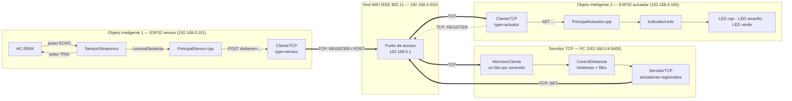
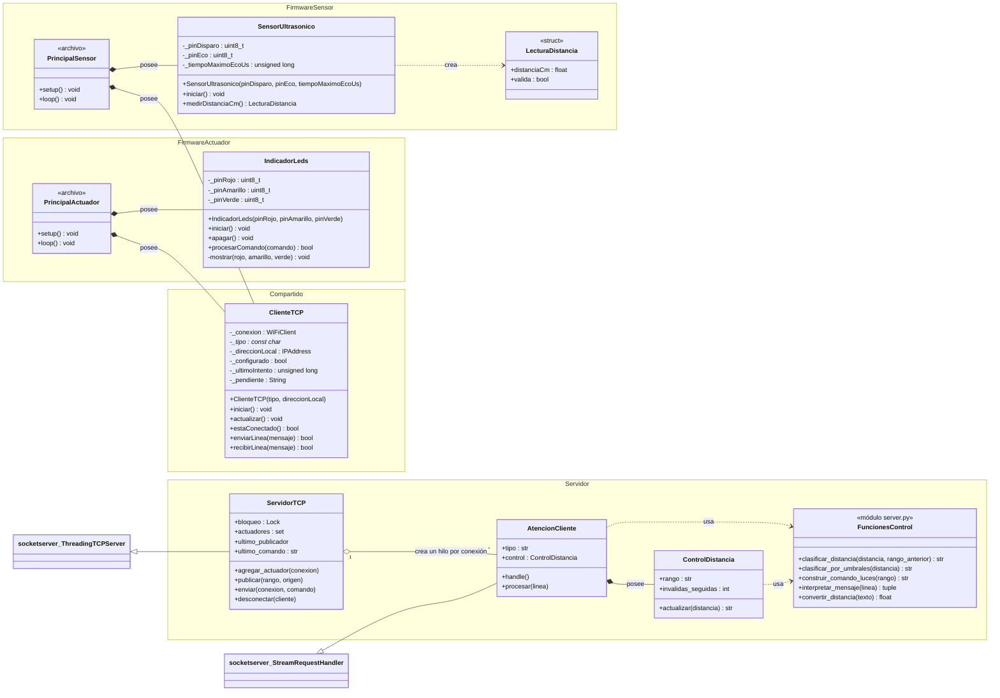
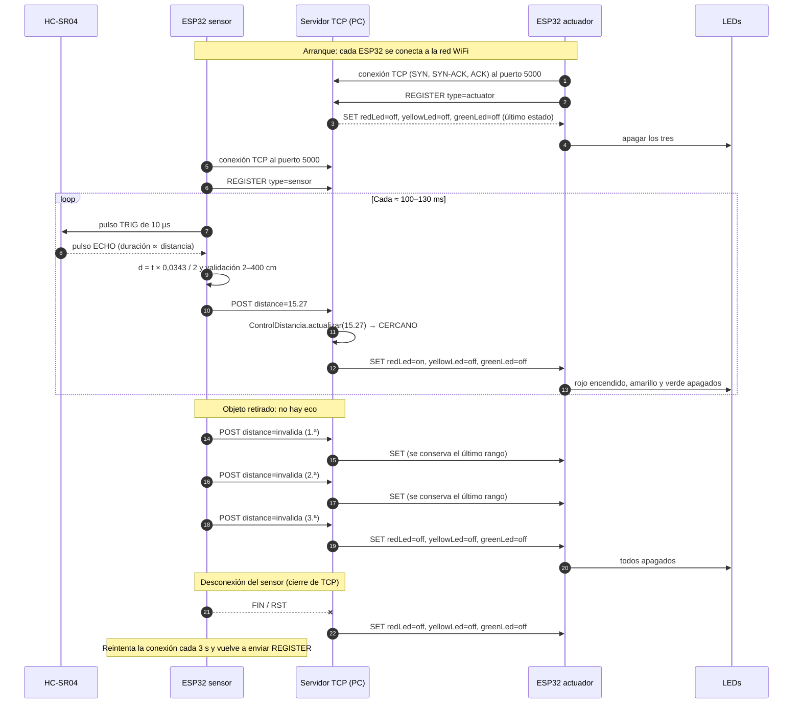
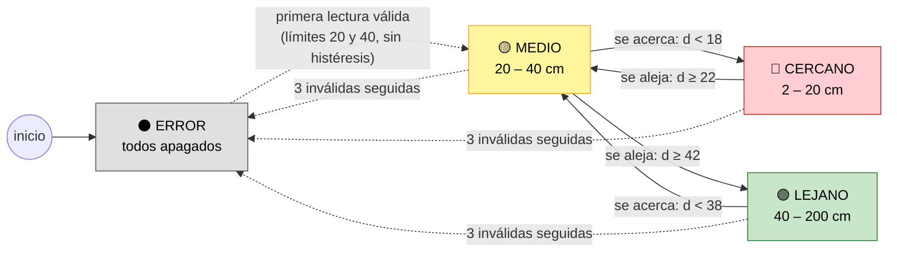
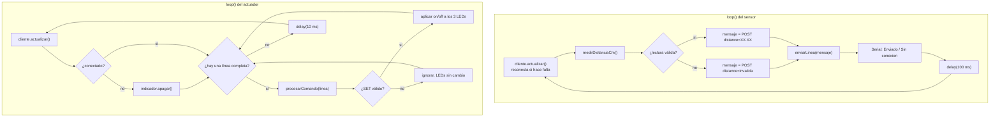

# Informe Técnico — Práctica 2: Integración de Objetos Inteligentes con TCP/IP

| | |
| --- | --- |
| **Asignatura** | Internet de las Cosas [SIS-234] — 2-2026 |
| **Carrera** | Ingeniería de Sistemas |
| **Actividad** | Integración de objetos inteligentes con TCP/IP |
| **Repositorio** | https://github.com/lucianaaaaaaa/proyecto2.git |
| **Fecha** | 13 Octubre de 2026 |
| **Integrantes** | Alejandro Machaca Villena - Rubén Cordero Martinez - Luciana Leaño Guerrero |


---

## Contenido

1. [Requerimientos Funcionales y No Funcionales](#1-requerimientos-funcionales-y-no-funcionales)
2. [Análisis y Diseño](#2-análisis-y-diseño)
3. [Desarrollo e Implementación](#3-desarrollo-e-implementación)
4. [Pruebas y Validaciones](#4-pruebas-y-validaciones)
5. [Resultados](#5-resultados)
6. [Conclusiones](#6-conclusiones)
7. [Recomendaciones](#7-recomendaciones)
8. [Anexos](#8-anexos)

---

# 1. Requerimientos Funcionales y No Funcionales

El sistema es distribuido y tiene tres nodos conectados a la misma red WiFi (IEEE 802.11):

- **Objeto inteligente sensor:** un ESP32 con un sensor ultrasónico HC-SR04. Mide la distancia y la envía al servidor.
- **Servidor TCP:** un programa Python que corre en una PC. Recibe las distancias, ejecuta el algoritmo de control y decide qué LED debe encenderse.
- **Objeto inteligente actuador:** un ESP32 con tres LEDs (rojo, amarillo y verde). Ejecuta las órdenes del servidor.

Los objetos no se comunican directamente entre sí: toda la información pasa por el servidor. El actuador no conoce los rangos de distancia y el sensor no conoce los LEDs; la decisión está concentrada en un solo lugar.

## 1.1 Requerimientos funcionales

| ID | Requerimiento | Criterio de aceptación |
| --- | --- | --- |
| **RF1** | El objeto sensor debe medir la distancia entre el HC-SR04 y un objeto. | Cada medición produce una distancia en centímetros y un indicador de validez. La ausencia de eco y las distancias fuera de 2–400 cm se reportan como `invalida`. |
| **RF2** | El servidor debe clasificar la distancia en tres rangos contiguos y sin solapamiento, con histéresis. | Toda lectura válida entre 2 y 200 cm produce exactamente uno de `CERCANO`, `MEDIO` o `LEJANO`. Las transiciones respetan el margen de histéresis de 2 cm (§1.1.2). |
| **RF3** | El objeto actuador debe activar un LED distinto según el rango. | `CERCANO` → solo rojo; `MEDIO` → solo amarillo; `LEJANO` → solo verde; `ERROR` → los tres apagados. Nunca hay más de un LED encendido. |
| **RF4** | Las lecturas y los comandos deben viajar por sockets TCP sobre WiFi, con un protocolo de aplicación propio. | El sensor envía `POST` al servidor y el servidor envía `SET` al actuador por TCP, puerto 5000, con el formato de §2.6. |
| **RF5** | Cada cliente debe identificarse al conectarse, y el servidor debe sincronizar a los actuadores. | Cada cliente envía `REGISTER type=sensor` o `REGISTER type=actuator`. Solo se aceptan `POST` de clientes registrados como sensor. Un actuador que se registra recibe de inmediato el último estado conocido. |
| **RF6** | El sistema debe tolerar lecturas inválidas aisladas del sensor. | Una o dos lecturas inválidas seguidas no cambian el estado de los LEDs. A la tercera lectura inválida consecutiva el rango pasa a `ERROR`. |
| **RF7** | El sistema debe tener un comportamiento de fallo seguro. | Si el sensor que publicó el último dato se desconecta, el servidor ordena apagar los LEDs. Si el actuador pierde la conexión con el servidor, apaga sus LEDs por sí mismo. |
| **RF8** | Los clientes deben reconectarse automáticamente. | Si se pierde el WiFi o el servidor, cada ESP32 reintenta la conexión TCP cada 3 s y se vuelve a registrar sin intervención manual. |
| **RF9** | El protocolo debe rechazar mensajes inválidos sin afectar al sistema. | El servidor ignora mensajes desconocidos y cierra las conexiones con líneas de más de 192 caracteres. El actuador ignora un `SET` mal formado y conserva el estado actual de los LEDs. |

### 1.1.1 Rangos y lógica de control

El rango de trabajo es de **2 a 200 cm**, con ambos límites incluidos.

| Distancia o condición | Rango lógico | Comando enviado al actuador | LEDs |
| --- | --- | --- | --- |
| 3 lecturas inválidas seguidas (sin eco, < 2 cm, > 200 cm o valor no numérico) | `ERROR` | `SET redLed=off, yellowLed=off, greenLed=off` | Todos apagados |
| 2 cm ≤ d < 20 cm | `CERCANO` | `SET redLed=on, yellowLed=off, greenLed=off` | Rojo |
| 20 cm ≤ d < 40 cm | `MEDIO` | `SET redLed=off, yellowLed=on, greenLed=off` | Amarillo |
| 40 cm ≤ d ≤ 200 cm | `LEJANO` | `SET redLed=off, yellowLed=off, greenLed=on` | Verde |

Los intervalos son contiguos y no se solapan: los valores exactos de 20 y 40 cm pertenecen al rango superior.

### 1.1.2 Histéresis

Para evitar el parpadeo cuando el objeto está justo sobre un límite, se usa un margen de **2 cm**. La histéresis no crea un cuarto rango; solo define cuándo se confirma una transición:

| Rango actual | Se mantiene mientras | Cambia cuando |
| --- | --- | --- |
| `CERCANO` | d < 22 cm | d ≥ 22 cm → se reclasifica con los límites base |
| `MEDIO` | 18 cm ≤ d < 42 cm | d < 18 cm → `CERCANO`; d ≥ 42 cm → `LEJANO` |
| `LEJANO` | d ≥ 38 cm | d < 38 cm → se reclasifica con los límites base |
| `ERROR` | — | La siguiente lectura válida se clasifica directamente con 20 y 40 cm |

### 1.1.3 Filtro de lecturas inválidas

El HC-SR04 produce lecturas inválidas aisladas (sin eco o con valores falsos). Si una sola de ellas llevara el sistema a `ERROR`, los LEDs se apagarían por un instante y, además, la lectura siguiente se clasificaría **sin histéresis**, porque después de `ERROR` se usan los límites base. Cerca de 40 cm, eso produciría una oscilación amarillo/verde. Por eso, una lectura inválida solo cambia el rango si se repite **3 veces seguidas**. Mientras tanto se conserva el último rango válido, y con él la memoria de la histéresis. Cualquier lectura válida reinicia el conteo. A 10 lecturas por segundo, el sistema tarda unos 0,3 s en pasar a `ERROR`.

## 1.2 Requerimientos no funcionales

Los valores son objetivos medibles. Su verificación está en la sección 4.

| ID | Atributo | Requerimiento medible | Forma de verificación |
| --- | --- | --- | --- |
| **RNF1** | Estabilidad | El sistema completo opera **≥ 10 min** continuos sin reinicios, bloqueos ni desconexiones permanentes. | Prueba cronometrada del sistema completo (PH-09) y prueba de 10 min del servidor (PS-04). |
| **RNF2** | Exactitud | Error individual **≤ ±3 cm** frente a una cinta métrica, en 10–200 cm. | 10 lecturas por punto en 8 distancias (PH-03). |
| **RNF3** | Tiempo de respuesta | El LED refleja un cambio de rango en **≤ 1 s**, medido de extremo a extremo (sensor → servidor → actuador). | Marcas de tiempo del monitor serie y de la consola del servidor (PH-07). |
| **RNF4** | Frecuencia de muestreo | **≥ 2 lecturas/s** recibidas por el servidor (valor de diseño: ≈ 7–10 lecturas/s). | Conteo de mensajes en un intervalo conocido (PH-06). |
| **RNF5** | Latencia del servidor | Procesamiento `POST` → `SET` **≤ 50 ms en el percentil 99**. | Medición automatizada de 10 min (PS-04). |
| **RNF6** | Recuperación | Tras restablecer el servidor, ambos clientes se reconectan y el sistema vuelve a operar en **≤ 10 s**. | Prueba de reinicio del servidor (PH-08). |
| **RNF7** | Detección de fallos | Los LEDs se apagan en **≤ 1 s** después de perder el objeto (lecturas inválidas) o de desconectarse el sensor de forma ordenada. | Pruebas PS-05 y PH-08. |
| **RNF8** | Calidad del código | Código modular (POO), documentado y conforme a las convenciones; compila **sin advertencias**. | Compilación, pruebas automatizadas y revisión estática (PS-01, PS-02, PS-06). |
| **RNF9** | Uso de recursos | Cada firmware usa **≤ 25 % de RAM** y **≤ 70 % de flash** del ESP32. | Informe de memoria de PlatformIO (PS-01). |

## 1.3 Matriz de trazabilidad

| Requisito | Elemento de diseño | Implementación | Verificación |
| --- | --- | --- | --- |
| **RF1** | Adquisición en el objeto sensor | [`SensorUltrasonico::medirDistanciaCm()`](../src/cliente/SensorUltrasonico.cpp), `LecturaDistancia` | PS-02, PH-03 |
| **RF2** | Algoritmo de control en el servidor | [`clasificar_distancia()`](../src/servidor/server.py), `clasificar_por_umbrales()` | PS-03, PH-04, PH-05 |
| **RF3** | Actuador sin lógica de rangos | [`IndicadorLeds::procesarComando()`](../src/cliente/IndicadorLeds.cpp), `LEDS_POR_RANGO` | PS-02, PS-03, PH-04 |
| **RF4** | Protocolo de aplicación sobre TCP | [`ClienteTCP`](../src/cliente/ClienteTCP.cpp), `AtencionCliente`, `ServidorTCP` | PS-03, PS-05, PH-02 |
| **RF5** | Registro y sincronización | `ClienteTCP::actualizar()`, `AtencionCliente.procesar()`, `ServidorTCP.agregar_actuador()` | PS-03, PS-05, PH-02 |
| **RF6** | Filtro de inválidas | [`ControlDistancia`](../src/servidor/server.py), `LECTURAS_INVALIDAS_PARA_ERROR` | PS-03, PS-05, PH-05 |
| **RF7** | Fallo seguro | `ServidorTCP.desconectar()`, `loop()` de [`PrincipalActuador.cpp`](../src/cliente/PrincipalActuador.cpp) | PS-03, PH-08 |
| **RF8** | Reconexión | `ClienteTCP::actualizar()`, `REINTENTO_CONEXION_MS`, `WiFi.setAutoReconnect()` | PH-08 |
| **RF9** | Validación del protocolo | `LONGITUD_MAXIMA_MENSAJE`, `ClienteTCP::recibirLinea()`, `leerEstadoLed()` | PS-02, PS-03 |
| **RNF1** | Hilo por cliente, reconexión y tiempos acotados | `ThreadingTCPServer`, `TIEMPO_MAXIMO_ECO_US`, `TIEMPO_MAXIMO_CONEXION_MS` | PS-04, PH-09 |
| **RNF2** | Conversión del eco | `VELOCIDAD_SONIDO_CM_US` | PH-03 |
| **RNF3** | Envío inmediato y radio sin ahorro de energía | `WiFi.setSleep(false)`, `INTERVALO_MEDICION_MS`, `delay(10)` en el actuador | PS-04 (servidor), PH-07 |
| **RNF4** | Ciclo periódico de medición | `loop()` de [`PrincipalSensor.cpp`](../src/cliente/PrincipalSensor.cpp) | PS-04, PH-06 |
| **RNF5** | Servidor sin espera activa, con bloqueo corto | `ServidorTCP.publicar()`, `threading.Lock` | PS-04 |
| **RNF6** | Reintento periódico | `REINTENTO_CONEXION_MS = 3000` | PH-08 |
| **RNF7** | Filtro de 3 lecturas y aviso por desconexión | `ControlDistancia`, `ServidorTCP.desconectar()` | PS-05, PH-08 |
| **RNF8** | Clases con responsabilidad única, comentarios y docstrings | Todos los archivos de [`src/`](../src) | PS-01, PS-02, PS-06 |
| **RNF9** | Firmware separado por objeto | `build_src_filter` en [`platformio.ini`](../platformio.ini) | PS-01 |

---

# 2. Análisis y Diseño

## 2.1 Ubicación del sistema en el modelo TCP/IP

| Capa TCP/IP | Implementación en el proyecto |
| --- | --- |
| **Aplicación** | Protocolo propio basado en texto: `REGISTER`, `POST` y `SET` (§2.6). |
| **Transporte** | TCP, puerto 5000. Garantiza entrega en orden y sin duplicados, por eso el protocolo no necesita números de secuencia ni confirmaciones propias. |
| **Internet** | IPv4. Red `192.168.0.0/24` con IP fijas: actuador `.100`, sensor `.101` y servidor `.9`. |
| **Acceso a la red** | WiFi IEEE 802.11 b/g/n en 2,4 GHz (radio del ESP32) y la tarjeta de red de la PC. |

Se eligió **TCP** en lugar de UDP porque un comando `SET` perdido dejaría el LED en un estado incorrecto hasta el siguiente mensaje, y porque TCP permite detectar la desconexión de un cliente, que se usa para el fallo seguro (RF7). Se eligió la arquitectura **cliente-servidor** con los dos ESP32 como clientes porque así la PC no necesita conocer las IP de las placas: son las placas las que inician la conexión.

## 2.2 Diagrama de arquitectura del sistema



### 2.2.1 Responsabilidades de cada nodo

| Nodo | Entrada | Salida | Responsabilidad | No hace |
| --- | --- | --- | --- | --- |
| Objeto sensor | Eco del HC-SR04 | `POST distance=<cm>` cada ≈ 100–130 ms | Medir, validar físicamente (2–400 cm) y transmitir. | No clasifica ni conoce los LEDs. |
| Servidor TCP | `REGISTER`, `POST` | `SET` hacia todos los actuadores | Registrar clientes, ejecutar el algoritmo de control y distribuir el comando. Aplicar el fallo seguro. | No accede a hardware. |
| Objeto actuador | `SET ...` | Niveles en 3 GPIO | Ejecutar el estado recibido. Apagar los LEDs si pierde el servidor. | No conoce distancias ni rangos. |

### 2.2.2 Decisión: el algoritmo de control vive solo en el servidor

La clasificación se ejecuta **solo en el servidor**; los clientes no contienen ninguna regla de rangos. Así hay una única fuente de verdad para los umbrales y la histéresis. Esto permite cambiar las reglas sin reprogramar las placas y cumple el enunciado ("el servidor deberá ejecutar un algoritmo de control").

El sensor solo descarta lo que es **físicamente imposible** para el HC-SR04 (< 2 cm o > 400 cm). El **rango de trabajo** (2–200 cm) es una regla de negocio y la aplica el servidor. Por eso hay dos validaciones con límites distintos, pero con propósitos diferentes y documentados.

## 2.3 Diagramas de circuito

Los diagramas representan el **montaje real utilizado en el prototipo**. Ambos ESP32 se alimentan por el conector USB (5 V) desde la PC o un cargador. El regulador de la placa genera los 3,3 V de la lógica y del módulo WiFi, y en cada objeto todas las tierras son comunes.

**Niveles de tensión de las señales**

| Señal | Origen → destino | Nivel alto | Límite del receptor | Situación |
| --- | --- | ---: | ---: | --- |
| Alimentación del HC-SR04 | Pin 5V/VIN (USB) → VCC | 5 V | 4,5–5,5 V (HC-SR04) | Correcta |
| TRIG | GPIO25 → HC-SR04 | 3,3 V | Entrada alta del HC-SR04 ≈ 2,0 V o más | Correcta: 3,3 V se reconoce como alto |
| LEDs | GPIO13/27/14 → LED → resistencia → GND | 3,3 V | 40 mA máximo por GPIO | Correcta (≈ 5–6 mA) |

### 2.3.1 Objeto inteligente 1 — Sensor

```text
                 ESP32 DevKit                          HC-SR04
            ┌───────────────────┐                ┌──────────────┐
  USB 5 V ──┤ VIN / 5V  ────────┼────────────────┤ VCC  (5 V)   │
            │                   │                │              │
            │ GPIO25 (salida)  ─┼───── 3,3 V ───►│ TRIG         │
            │                   │                │              │
            │ GPIO26 (entrada) ◄┼────────────────┤ ECHO         │
            │                   │                │              │
            │ GND ──────────────┼────────────────┤ GND          │
            └───────────────────┘                └──────────────┘
```

| Elemento | Conexión | Justificación |
| --- | --- | --- |
| HC-SR04 VCC | Pin 5V/VIN del ESP32 | El módulo requiere 5 V para funcionar. |
| HC-SR04 GND | GND común | Referencia común de tensión. |
| HC-SR04 TRIG | GPIO25 | 3,3 V supera el umbral de entrada alta del HC-SR04; no requiere adaptación. |
| HC-SR04 ECHO | GPIO26 | Entrada del pulso de eco, cuya duración es proporcional a la distancia; se mide con `pulseIn()`. |

### 2.3.2 Objeto inteligente 2 — Actuador

```text
                 ESP32 DevKit
            ┌──────────────────┐  cable macho-macho    LED       220 Ω   línea GND
            │                  │                                        (protoboard)
            │ GPIO13 ──────────┼──────────────►|── rojo ─────[ 220 Ω ]──┐
            │                  │         ánodo   cátodo                 │
            │ GPIO27 ──────────┼──────────────►|── amarillo ─[ 220 Ω ]──┤
            │                  │                                        │
            │ GPIO14 ──────────┼──────────────►|── verde ────[ 220 Ω ]──┤
            │                  │                                        │
            │ GND ─────────────┼────────────────────────────────────────┘
            └──────────────────┘
```

Cada GPIO se conecta con un cable macho-macho a la pata larga (ánodo) de su LED. La resistencia de 220 Ω va desde la pata corta (cátodo) hasta la línea negativa (GND) del protoboard, que está unida al GND del ESP32. Como LED y resistencia están en serie, la posición de la resistencia (antes o después del LED) no cambia la corriente.

| LED | GPIO | Caída típica (Vf) | Corriente estimada I = (3,3 V − Vf) / 220 Ω |
| --- | --- | --- | --- |
| Rojo | GPIO13 | ≈ 2,0 V | ≈ 5,9 mA |
| Amarillo | GPIO27 | ≈ 2,1 V | ≈ 5,5 mA |
| Verde | GPIO14 | ≈ 2,2 V | ≈ 5,0 mA |

Las tres corrientes son del orden de 5–6 mA, muy por debajo del máximo de 40 mA por GPIO del ESP32. Como el sistema enciende un solo LED a la vez, el consumo de la salida es de ≈ 6 mA como máximo.

## 2.4 Diagrama de clases



`ClienteTCP` es la **misma clase** para ambos firmwares: solo cambia el tipo con que se registra (`"sensor"` o `"actuator"`) y la IP local. Así se evita duplicar la lógica de WiFi, reconexión y enmarcado de líneas.

## 2.5 Diagramas de comportamiento

### 2.5.1 Diagrama de secuencia — operación completa



### 2.5.2 Diagrama de estados — algoritmo de control en el servidor

El servidor tiene cuatro estados. Cada uno corresponde a un LED encendido (o a ninguno, en `ERROR`). Los tres rangos se ordenan de cerca a lejos y, por la histéresis, **para salir de un estado hay que pasar el límite por 2 cm**:




### 2.5.3 Diagrama de actividad — firmware de cada objeto

