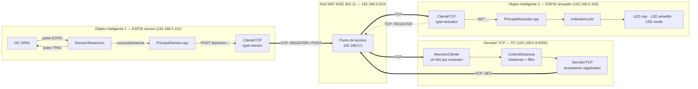
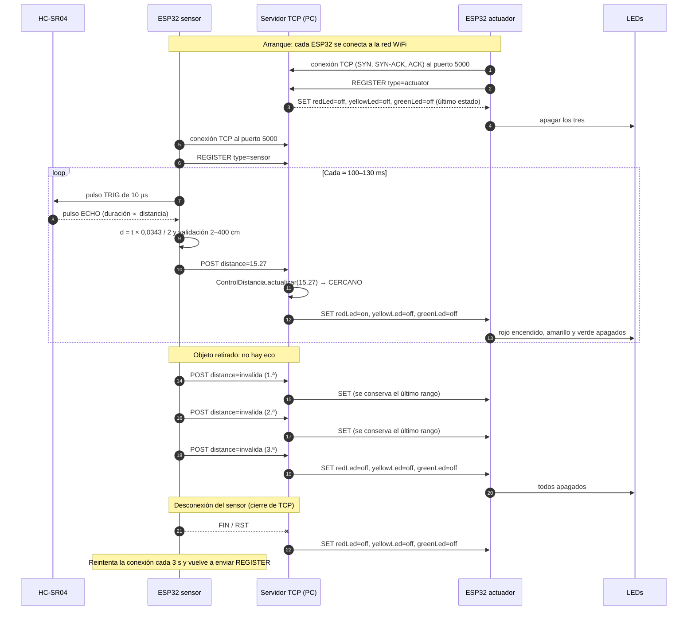
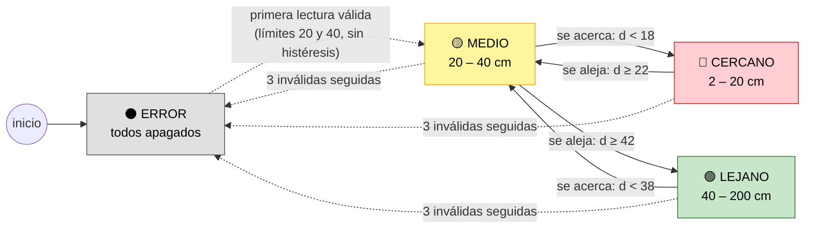
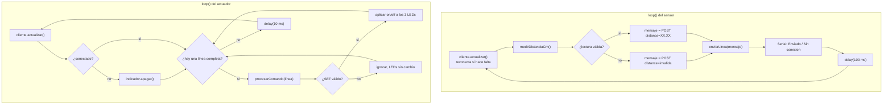
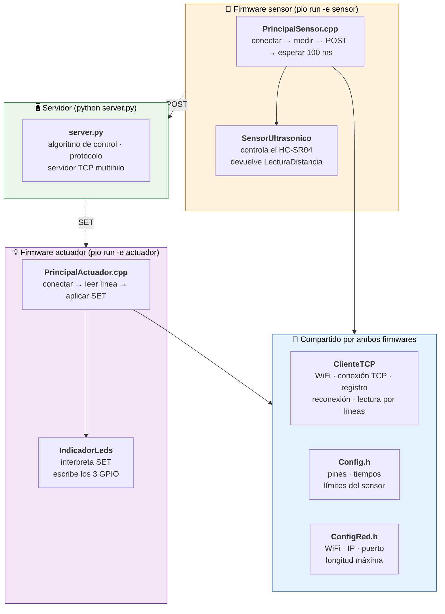

# Informe Técnico — Práctica 2: Integración de Objetos Inteligentes con TCP/IP

| | |
| --- | --- |
| **Asignatura** | Internet de las Cosas [SIS-234] — 2-2026 |
| **Carrera** | Ingeniería de Sistemas |
| **Actividad** | Integración de objetos inteligentes con TCP/IP |
| **Repositorio** | https://github.com/lucianaaaaaaa/proyecto2.git |
| **Fecha** | 13 Octubre de 2026 |
| **Integrantes** | Alejandro Machaca Villena - Rubén Cordero Martinez - Luciana Leaño Guerrero |


---

## Contenido

1. [Requerimientos Funcionales y No Funcionales](#1-requerimientos-funcionales-y-no-funcionales)
2. [Análisis y Diseño](#2-análisis-y-diseño)
3. [Desarrollo e Implementación](#3-desarrollo-e-implementación)
4. [Pruebas y Validaciones](#4-pruebas-y-validaciones)
5. [Resultados](#5-resultados)
6. [Conclusiones](#6-conclusiones)
7. [Recomendaciones](#7-recomendaciones)
8. [Anexos](#8-anexos)

---

# 1. Requerimientos Funcionales y No Funcionales

El sistema es distribuido y tiene tres nodos conectados a la misma red WiFi (IEEE 802.11):

- **Objeto inteligente sensor:** un ESP32 con un sensor ultrasónico HC-SR04. Mide la distancia y la envía al servidor.
- **Servidor TCP:** un programa Python que corre en una PC. Recibe las distancias, ejecuta el algoritmo de control y decide qué LED debe encenderse.
- **Objeto inteligente actuador:** un ESP32 con tres LEDs (rojo, amarillo y verde). Ejecuta las órdenes del servidor.

Los objetos no se comunican directamente entre sí: toda la información pasa por el servidor. El actuador no conoce los rangos de distancia y el sensor no conoce los LEDs; la decisión está concentrada en un solo lugar.

## 1.1 Requerimientos funcionales

| ID | Requerimiento | Criterio de aceptación |
| --- | --- | --- |
| **RF1** | El objeto sensor debe medir la distancia entre el HC-SR04 y un objeto. | Cada medición produce una distancia en centímetros y un indicador de validez. La ausencia de eco y las distancias fuera de 2–400 cm se reportan como `invalida`. |
| **RF2** | El servidor debe clasificar la distancia en tres rangos contiguos y sin solapamiento, con histéresis. | Toda lectura válida entre 2 y 200 cm produce exactamente uno de `CERCANO`, `MEDIO` o `LEJANO`. Las transiciones respetan el margen de histéresis de 2 cm (§1.1.2). |
| **RF3** | El objeto actuador debe activar un LED distinto según el rango. | `CERCANO` → solo rojo; `MEDIO` → solo amarillo; `LEJANO` → solo verde; `ERROR` → los tres apagados. Nunca hay más de un LED encendido. |
| **RF4** | Las lecturas y los comandos deben viajar por sockets TCP sobre WiFi, con un protocolo de aplicación propio. | El sensor envía `POST` al servidor y el servidor envía `SET` al actuador por TCP, puerto 5000, con el formato de §2.6. |
| **RF5** | Cada cliente debe identificarse al conectarse, y el servidor debe sincronizar a los actuadores. | Cada cliente envía `REGISTER type=sensor` o `REGISTER type=actuator`. Solo se aceptan `POST` de clientes registrados como sensor. Un actuador que se registra recibe de inmediato el último estado conocido. |
| **RF6** | El sistema debe tolerar lecturas inválidas aisladas del sensor. | Una o dos lecturas inválidas seguidas no cambian el estado de los LEDs. A la tercera lectura inválida consecutiva el rango pasa a `ERROR`. |
| **RF7** | El sistema debe tener un comportamiento de fallo seguro. | Si el sensor que publicó el último dato se desconecta, el servidor ordena apagar los LEDs. Si el actuador pierde la conexión con el servidor, apaga sus LEDs por sí mismo. |
| **RF8** | Los clientes deben reconectarse automáticamente. | Si se pierde el WiFi o el servidor, cada ESP32 reintenta la conexión TCP cada 3 s y se vuelve a registrar sin intervención manual. |
| **RF9** | El protocolo debe rechazar mensajes inválidos sin afectar al sistema. | El servidor ignora mensajes desconocidos y cierra las conexiones con líneas de más de 192 caracteres. El actuador ignora un `SET` mal formado y conserva el estado actual de los LEDs. |

### 1.1.1 Rangos y lógica de control

El rango de trabajo es de **2 a 200 cm**, con ambos límites incluidos.

| Distancia o condición | Rango lógico | Comando enviado al actuador | LEDs |
| --- | --- | --- | --- |
| 3 lecturas inválidas seguidas (sin eco, < 2 cm, > 200 cm o valor no numérico) | `ERROR` | `SET redLed=off, yellowLed=off, greenLed=off` | Todos apagados |
| 2 cm ≤ d < 20 cm | `CERCANO` | `SET redLed=on, yellowLed=off, greenLed=off` | Rojo |
| 20 cm ≤ d < 40 cm | `MEDIO` | `SET redLed=off, yellowLed=on, greenLed=off` | Amarillo |
| 40 cm ≤ d ≤ 200 cm | `LEJANO` | `SET redLed=off, yellowLed=off, greenLed=on` | Verde |

Los intervalos son contiguos y no se solapan: los valores exactos de 20 y 40 cm pertenecen al rango superior.

### 1.1.2 Histéresis

Para evitar el parpadeo cuando el objeto está justo sobre un límite, se usa un margen de **2 cm**. La histéresis no crea un cuarto rango; solo define cuándo se confirma una transición:

| Rango actual | Se mantiene mientras | Cambia cuando |
| --- | --- | --- |
| `CERCANO` | d < 22 cm | d ≥ 22 cm → se reclasifica con los límites base |
| `MEDIO` | 18 cm ≤ d < 42 cm | d < 18 cm → `CERCANO`; d ≥ 42 cm → `LEJANO` |
| `LEJANO` | d ≥ 38 cm | d < 38 cm → se reclasifica con los límites base |
| `ERROR` | — | La siguiente lectura válida se clasifica directamente con 20 y 40 cm |

### 1.1.3 Filtro de lecturas inválidas

El HC-SR04 produce lecturas inválidas aisladas (sin eco o con valores falsos). Si una sola de ellas llevara el sistema a `ERROR`, los LEDs se apagarían por un instante y, además, la lectura siguiente se clasificaría **sin histéresis**, porque después de `ERROR` se usan los límites base. Cerca de 40 cm, eso produciría una oscilación amarillo/verde. Por eso, una lectura inválida solo cambia el rango si se repite **3 veces seguidas**. Mientras tanto se conserva el último rango válido, y con él la memoria de la histéresis. Cualquier lectura válida reinicia el conteo. A 10 lecturas por segundo, el sistema tarda unos 0,3 s en pasar a `ERROR`.

## 1.2 Requerimientos no funcionales

Los valores son objetivos medibles. Su verificación está en la sección 4.

| ID | Atributo | Requerimiento medible | Forma de verificación |
| --- | --- | --- | --- |
| **RNF1** | Estabilidad | El sistema completo opera **≥ 10 min** continuos sin reinicios, bloqueos ni desconexiones permanentes. | Prueba cronometrada del sistema completo (PH-09) y prueba de 10 min del servidor (PS-04). |
| **RNF2** | Exactitud | Error individual **≤ ±3 cm** frente a una cinta métrica, en 10–200 cm. | 10 lecturas por punto en 8 distancias (PH-03). |
| **RNF3** | Tiempo de respuesta | El LED refleja un cambio de rango en **≤ 1 s**, medido de extremo a extremo (sensor → servidor → actuador). | Marcas de tiempo del monitor serie y de la consola del servidor (PH-07). |
| **RNF4** | Frecuencia de muestreo | **≥ 2 lecturas/s** recibidas por el servidor (valor de diseño: ≈ 7–10 lecturas/s). | Conteo de mensajes en un intervalo conocido (PH-06). |
| **RNF5** | Latencia del servidor | Procesamiento `POST` → `SET` **≤ 50 ms en el percentil 99**. | Medición automatizada de 10 min (PS-04). |
| **RNF6** | Recuperación | Tras restablecer el servidor, ambos clientes se reconectan y el sistema vuelve a operar en **≤ 10 s**. | Prueba de reinicio del servidor (PH-08). |
| **RNF7** | Detección de fallos | Los LEDs se apagan en **≤ 1 s** después de perder el objeto (lecturas inválidas) o de desconectarse el sensor de forma ordenada. | Pruebas PS-05 y PH-08. |
| **RNF8** | Calidad del código | Código modular (POO), documentado y conforme a las convenciones; compila **sin advertencias**. | Compilación, pruebas automatizadas y revisión estática (PS-01, PS-02, PS-06). |
| **RNF9** | Uso de recursos | Cada firmware usa **≤ 25 % de RAM** y **≤ 70 % de flash** del ESP32. | Informe de memoria de PlatformIO (PS-01). |

## 1.3 Matriz de trazabilidad

| Requisito | Elemento de diseño | Implementación | Verificación |
| --- | --- | --- | --- |
| **RF1** | Adquisición en el objeto sensor | [`SensorUltrasonico::medirDistanciaCm()`](../src/cliente/SensorUltrasonico.cpp), `LecturaDistancia` | PS-02, PH-03 |
| **RF2** | Algoritmo de control en el servidor | [`clasificar_distancia()`](../src/servidor/server.py), `clasificar_por_umbrales()` | PS-03, PH-04, PH-05 |
| **RF3** | Actuador sin lógica de rangos | [`IndicadorLeds::procesarComando()`](../src/cliente/IndicadorLeds.cpp), `LEDS_POR_RANGO` | PS-02, PS-03, PH-04 |
| **RF4** | Protocolo de aplicación sobre TCP | [`ClienteTCP`](../src/cliente/ClienteTCP.cpp), `AtencionCliente`, `ServidorTCP` | PS-03, PS-05, PH-02 |
| **RF5** | Registro y sincronización | `ClienteTCP::actualizar()`, `AtencionCliente.procesar()`, `ServidorTCP.agregar_actuador()` | PS-03, PS-05, PH-02 |
| **RF6** | Filtro de inválidas | [`ControlDistancia`](../src/servidor/server.py), `LECTURAS_INVALIDAS_PARA_ERROR` | PS-03, PS-05, PH-05 |
| **RF7** | Fallo seguro | `ServidorTCP.desconectar()`, `loop()` de [`PrincipalActuador.cpp`](../src/cliente/PrincipalActuador.cpp) | PS-03, PH-08 |
| **RF8** | Reconexión | `ClienteTCP::actualizar()`, `REINTENTO_CONEXION_MS`, `WiFi.setAutoReconnect()` | PH-08 |
| **RF9** | Validación del protocolo | `LONGITUD_MAXIMA_MENSAJE`, `ClienteTCP::recibirLinea()`, `leerEstadoLed()` | PS-02, PS-03 |
| **RNF1** | Hilo por cliente, reconexión y tiempos acotados | `ThreadingTCPServer`, `TIEMPO_MAXIMO_ECO_US`, `TIEMPO_MAXIMO_CONEXION_MS` | PS-04, PH-09 |
| **RNF2** | Conversión del eco | `VELOCIDAD_SONIDO_CM_US` | PH-03 |
| **RNF3** | Envío inmediato y radio sin ahorro de energía | `WiFi.setSleep(false)`, `INTERVALO_MEDICION_MS`, `delay(10)` en el actuador | PS-04 (servidor), PH-07 |
| **RNF4** | Ciclo periódico de medición | `loop()` de [`PrincipalSensor.cpp`](../src/cliente/PrincipalSensor.cpp) | PS-04, PH-06 |
| **RNF5** | Servidor sin espera activa, con bloqueo corto | `ServidorTCP.publicar()`, `threading.Lock` | PS-04 |
| **RNF6** | Reintento periódico | `REINTENTO_CONEXION_MS = 3000` | PH-08 |
| **RNF7** | Filtro de 3 lecturas y aviso por desconexión | `ControlDistancia`, `ServidorTCP.desconectar()` | PS-05, PH-08 |
| **RNF8** | Clases con responsabilidad única, comentarios y docstrings | Todos los archivos de [`src/`](../src) | PS-01, PS-02, PS-06 |
| **RNF9** | Firmware separado por objeto | `build_src_filter` en [`platformio.ini`](../platformio.ini) | PS-01 |

---

# 2. Análisis y Diseño

## 2.1 Ubicación del sistema en el modelo TCP/IP

| Capa TCP/IP | Implementación en el proyecto |
| --- | --- |
| **Aplicación** | Protocolo propio basado en texto: `REGISTER`, `POST` y `SET` (§2.6). |
| **Transporte** | TCP, puerto 5000. Garantiza entrega en orden y sin duplicados, por eso el protocolo no necesita números de secuencia ni confirmaciones propias. |
| **Internet** | IPv4. Red `192.168.0.0/24` con IP fijas: actuador `.100`, sensor `.101` y servidor `.9`. |
| **Acceso a la red** | WiFi IEEE 802.11 b/g/n en 2,4 GHz (radio del ESP32) y la tarjeta de red de la PC. |

Se eligió **TCP** en lugar de UDP porque un comando `SET` perdido dejaría el LED en un estado incorrecto hasta el siguiente mensaje, y porque TCP permite detectar la desconexión de un cliente, que se usa para el fallo seguro (RF7). Se eligió la arquitectura **cliente-servidor** con los dos ESP32 como clientes porque así la PC no necesita conocer las IP de las placas: son las placas las que inician la conexión.

## 2.2 Diagrama de arquitectura del sistema



### 2.2.1 Responsabilidades de cada nodo

| Nodo | Entrada | Salida | Responsabilidad | No hace |
| --- | --- | --- | --- | --- |
| Objeto sensor | Eco del HC-SR04 | `POST distance=<cm>` cada ≈ 100–130 ms | Medir, validar físicamente (2–400 cm) y transmitir. | No clasifica ni conoce los LEDs. |
| Servidor TCP | `REGISTER`, `POST` | `SET` hacia todos los actuadores | Registrar clientes, ejecutar el algoritmo de control y distribuir el comando. Aplicar el fallo seguro. | No accede a hardware. |
| Objeto actuador | `SET ...` | Niveles en 3 GPIO | Ejecutar el estado recibido. Apagar los LEDs si pierde el servidor. | No conoce distancias ni rangos. |

### 2.2.2 Decisión: el algoritmo de control vive solo en el servidor

La clasificación se ejecuta **solo en el servidor**; los clientes no contienen ninguna regla de rangos. Así hay una única fuente de verdad para los umbrales y la histéresis. Esto permite cambiar las reglas sin reprogramar las placas y cumple el enunciado ("el servidor deberá ejecutar un algoritmo de control").

El sensor solo descarta lo que es **físicamente imposible** para el HC-SR04 (< 2 cm o > 400 cm). El **rango de trabajo** (2–200 cm) es una regla de negocio y la aplica el servidor. Por eso hay dos validaciones con límites distintos, pero con propósitos diferentes y documentados.

## 2.3 Diagramas de circuito

Los diagramas representan el **montaje real utilizado en el prototipo**. Ambos ESP32 se alimentan por el conector USB (5 V) desde la PC o un cargador. El regulador de la placa genera los 3,3 V de la lógica y del módulo WiFi, y en cada objeto todas las tierras son comunes.

**Niveles de tensión de las señales**

| Señal | Origen → destino | Nivel alto | Límite del receptor | Situación |
| --- | --- | ---: | ---: | --- |
| Alimentación del HC-SR04 | Pin 5V/VIN (USB) → VCC | 5 V | 4,5–5,5 V (HC-SR04) | Correcta |
| TRIG | GPIO25 → HC-SR04 | 3,3 V | Entrada alta del HC-SR04 ≈ 2,0 V o más | Correcta: 3,3 V se reconoce como alto |
| LEDs | GPIO13/27/14 → LED → resistencia → GND | 3,3 V | 40 mA máximo por GPIO | Correcta (≈ 5–6 mA) |

### 2.3.1 Objeto inteligente 1 — Sensor

```text
                 ESP32 DevKit                          HC-SR04
            ┌───────────────────┐                ┌──────────────┐
  USB 5 V ──┤ VIN / 5V  ────────┼────────────────┤ VCC  (5 V)   │
            │                   │                │              │
            │ GPIO25 (salida)  ─┼───── 3,3 V ───►│ TRIG         │
            │                   │                │              │
            │ GPIO26 (entrada) ◄┼────────────────┤ ECHO         │
            │                   │                │              │
            │ GND ──────────────┼────────────────┤ GND          │
            └───────────────────┘                └──────────────┘
```

| Elemento | Conexión | Justificación |
| --- | --- | --- |
| HC-SR04 VCC | Pin 5V/VIN del ESP32 | El módulo requiere 5 V para funcionar. |
| HC-SR04 GND | GND común | Referencia común de tensión. |
| HC-SR04 TRIG | GPIO25 | 3,3 V supera el umbral de entrada alta del HC-SR04; no requiere adaptación. |
| HC-SR04 ECHO | GPIO26 | Entrada del pulso de eco, cuya duración es proporcional a la distancia; se mide con `pulseIn()`. |

### 2.3.2 Objeto inteligente 2 — Actuador

```text
                 ESP32 DevKit
            ┌──────────────────┐  cable macho-macho    LED       220 Ω   línea GND
            │                  │                                        (protoboard)
            │ GPIO13 ──────────┼──────────────►|── rojo ─────[ 220 Ω ]──┐
            │                  │         ánodo   cátodo                 │
            │ GPIO27 ──────────┼──────────────►|── amarillo ─[ 220 Ω ]──┤
            │                  │                                        │
            │ GPIO14 ──────────┼──────────────►|── verde ────[ 220 Ω ]──┤
            │                  │                                        │
            │ GND ─────────────┼────────────────────────────────────────┘
            └──────────────────┘
```

Cada GPIO se conecta con un cable macho-macho a la pata larga (ánodo) de su LED. La resistencia de 220 Ω va desde la pata corta (cátodo) hasta la línea negativa (GND) del protoboard, que está unida al GND del ESP32. Como LED y resistencia están en serie, la posición de la resistencia (antes o después del LED) no cambia la corriente.

| LED | GPIO | Caída típica (Vf) | Corriente estimada I = (3,3 V − Vf) / 220 Ω |
| --- | --- | --- | --- |
| Rojo | GPIO13 | ≈ 2,0 V | ≈ 5,9 mA |
| Amarillo | GPIO27 | ≈ 2,1 V | ≈ 5,5 mA |
| Verde | GPIO14 | ≈ 2,2 V | ≈ 5,0 mA |

Las tres corrientes son del orden de 5–6 mA, muy por debajo del máximo de 40 mA por GPIO del ESP32. Como el sistema enciende un solo LED a la vez, el consumo de la salida es de ≈ 6 mA como máximo.

## 2.4 Diagrama de clases


`ClienteTCP` es la **misma clase** para ambos firmwares: solo cambia el tipo con que se registra (`"sensor"` o `"actuator"`) y la IP local. Así se evita duplicar la lógica de WiFi, reconexión y enmarcado de líneas.

## 2.5 Diagramas de comportamiento

### 2.5.1 Diagrama de secuencia — operación completa



### 2.5.2 Diagrama de estados — algoritmo de control en el servidor

El servidor tiene cuatro estados. Cada uno corresponde a un LED encendido (o a ninguno, en `ERROR`). Los tres rangos se ordenan de cerca a lejos y, por la histéresis, **para salir de un estado hay que pasar el límite por 2 cm**:




### 2.5.3 Diagrama de actividad — firmware de cada objeto



## 2.6 Especificación del protocolo de aplicación

### 2.6.1 Características generales

| Aspecto | Definición |
| --- | --- |
| Transporte | TCP. Servidor en el puerto **5000** (configurable con `--puerto`). |
| Iniciador | Siempre los clientes (ESP32). El servidor solo escucha. |
| Codificación | Texto ASCII / UTF-8 legible, para facilitar la depuración con el monitor serie y la consola. |
| Enmarcado | **Un mensaje por línea**, terminada en `\n` (LF). Se acepta `\r\n`, porque los extremos eliminan los espacios y el `\r`. |
| Longitud máxima | **192 caracteres** por línea. Una línea más larga se considera un error de protocolo y la conexión se cierra (en el servidor y en el cliente). |
| Forma general | `COMANDO clave=valor[, clave=valor]*` |
| Números | Decimal con punto y dos decimales (`15.27`). |
| Fragmentación | Los receptores acumulan bytes hasta encontrar `\n`; un mensaje puede llegar en varios segmentos TCP, o varios mensajes en uno solo. |

### 2.6.2 Gramática (ABNF simplificada)

```abnf
mensaje       = registro / publicacion / orden
registro      = "REGISTER type=" ( "sensor" / "actuator" ) LF
publicacion   = "POST distance=" ( decimal / "invalida" ) LF
orden         = "SET " estado-led ", " estado-led ", " estado-led LF
estado-led    = ( "redLed" / "yellowLed" / "greenLed" ) "=" ( "on" / "off" )
decimal       = 1*3DIGIT "." 2DIGIT
```

### 2.6.3 Mensajes

| Mensaje | Sentido | Cuándo se envía | Ejemplo | Tamaño |
| --- | --- | --- | --- | --- |
| `REGISTER` | Cliente → Servidor | Inmediatamente después de establecer la conexión TCP. | `REGISTER type=sensor` | 21–23 B |
| `POST` | Sensor → Servidor | Después de cada medición (≈ 7–10 veces por segundo). | `POST distance=37.52` | 19–23 B |
| `SET` | Servidor → Actuador | Después de cada `POST` procesado, al registrarse un actuador y cuando el sensor se desconecta. | `SET redLed=off, yellowLed=on, greenLed=off` | 43–44 B |

El servidor envía un `SET` por cada `POST`, aunque el rango no cambie. Esto hace que el actuador se resincronice continuamente con un costo de red mínimo (≈ 44 B × 10/s ≈ 0,44 kB/s).

### 2.6.4 Reglas de procesamiento y errores

| Situación | Comportamiento |
| --- | --- |
| `REGISTER` con tipo distinto de `sensor`/`actuator`, o un segundo `REGISTER` | Se ignora y se registra una advertencia en el servidor. |
| `POST` de un cliente no registrado como sensor | Se ignora (advertencia). |
| `POST distance=` con un valor no numérico, `nan`, `inf` o fuera de 2–200 cm | Cuenta como lectura inválida (filtro de 3). |
| Comando desconocido (`HOLA`) | Se ignora (advertencia). |
| Línea > 192 caracteres | Se cierra la conexión (en el servidor y en el cliente); el cliente se reconecta. |
| Línea con un byte nulo recibida por un ESP32, o con bytes que no son UTF-8 válido recibida por el servidor | Se cierra la conexión; el cliente se reconecta. |
| `SET` incompleto o con un valor distinto de `on`/`off` en el actuador | Se ignora; los LEDs conservan su estado. El orden de las claves no importa. |
| Desconexión del sensor que publicó el último dato | El servidor envía `SET` con los tres en `off`. |
| Pérdida de conexión en el actuador | El actuador apaga sus LEDs hasta reconectarse. |

### 2.6.5 Secuencia del protocolo

```text
Sensor                         Servidor                         Actuador
  │                               │◄──── REGISTER type=actuator ───┤
  │                               ├──── SET <último estado> ──────►│
  ├── REGISTER type=sensor ──────►│                                │
  ├── POST distance=15.27 ───────►│                                │
  │                               ├── SET redLed=on, ... ─────────►│
  ├── POST distance=invalida ────►│  (1.ª inválida: se conserva)   │
  │                               ├── SET redLed=on, ... ─────────►│
  │            ...                │              ...               │
```

## 2.7 Decisiones de diseño y riesgos analizados

| Decisión | Justificación | Riesgo o costo asumido |
| --- | --- | --- |
| Algoritmo de control solo en el servidor | Una sola fuente de verdad; las reglas se cambian sin reprogramar. | Si el servidor cae, no hay control (se mitiga con el fallo seguro). |
| Filtro de 3 lecturas inválidas | Conserva la histéresis ante lecturas falsas aisladas y evita apagones de un ciclo. | Retirar el objeto se detecta con ≈ 0,3 s de retraso. |
| Histéresis de 2 cm | Elimina el parpadeo en los límites. | Hay que alejar el objeto 2 cm más para confirmar un cambio. |
| Un `SET` por cada `POST` | Resincronización continua; no se necesitan confirmaciones. | Tráfico constante, aunque pequeño. |
| `WiFi.setSleep(false)` | Reduce la latencia de la radio (sin el ciclo de ahorro de energía). | Mayor consumo de las placas. |
| IP fijas | El sensor y el actuador encuentran siempre al servidor; los diagnósticos son reproducibles. | Hay que ajustar `ConfigRed.h` a cada red; `USAR_IP_FIJA = false` permite DHCP. |
| `ThreadingTCPServer` con `Lock` | Un hilo por cliente; un cliente lento no bloquea a los demás. El bloqueo protege el estado compartido. | Escala a pocos clientes, suficiente para el alcance. |
| Sin almacenar lecturas mientras no hay conexión | Un dato de distancia viejo no sirve para el control en tiempo real. | Se pierden las lecturas del periodo desconectado. |
| Detección de desconexión basada en TCP | No requiere mensajes adicionales. | **Una caída abrupta del sensor (corte de energía) no cierra el socket**: el servidor no lo detecta y el actuador conserva el último LED. Ver Recomendación 2. |

---

# 3. Desarrollo e Implementación

## 3.1 Entorno de desarrollo

| Elemento | Selección |
| --- | --- |
| Microcontroladores | 2 × ESP32 Dev Module (240 MHz, 320 KB de RAM, 4 MB de flash) |
| Framework del firmware | Arduino-ESP32 2.0.17 (`framework-arduinoespressif32 @ 3.20017`) sobre `espressif32@7.0.1` |
| Lenguaje del firmware | C++ |
| Herramienta de construcción | PlatformIO Core 6.2.0, entornos `sensor` y `actuador` |
| Servidor | Python 3.13, solo biblioteca estándar (`socketserver`, `threading`, `logging`, `argparse`) |
| Pruebas | `unittest` (Python) y un programa nativo C++ compilado con g++ y GPIO simulados |

[`platformio.ini`](../platformio.ini) genera **dos firmwares a partir del mismo código**, seleccionando los archivos con `build_src_filter`:

```ini
[env:sensor]
build_src_filter = +<cliente/PrincipalSensor.cpp> +<cliente/ClienteTCP.cpp> +<cliente/SensorUltrasonico.cpp>

[env:actuador]
build_src_filter = +<cliente/PrincipalActuador.cpp> +<cliente/ClienteTCP.cpp> +<cliente/IndicadorLeds.cpp>
```

## 3.2 Estructura del código fuente

El repositorio genera **tres programas**: dos firmwares para los ESP32 y el servidor en Python. Los dos firmwares comparten la comunicación (`ClienteTCP`) y la configuración; cada uno agrega solo la clase de su hardware.



Organización de carpetas:

```text
Proyecto_2_IOT/
├── platformio.ini                 Define los entornos "sensor" y "actuador"
├── src/
│   ├── cliente/                   Código de los ESP32 (C++)
│   │   ├── PrincipalSensor.cpp      [sensor]    setup() y loop() del sensor
│   │   ├── SensorUltrasonico.h/.cpp [sensor]    clase del HC-SR04
│   │   ├── PrincipalActuador.cpp    [actuador]  setup() y loop() del actuador
│   │   ├── IndicadorLeds.h/.cpp     [actuador]  clase de los 3 LEDs
│   │   ├── ClienteTCP.h/.cpp        [ambos]     comunicación con el servidor
│   │   ├── Config.h                 [ambos]     pines y tiempos
│   │   └── ConfigRed.h              [ambos]     red WiFi, IP y puerto
│   └── servidor/
│       └── server.py                [servidor]  control, protocolo y TCP
└── pruebas/
    ├── test_servidor.py             Pruebas unitarias y TCP del servidor
    ├── prueba_cliente.cpp           Prueba nativa del sensor y de los LEDs
    ├── soporte/Arduino.h            Arduino simulado para compilar en la PC
    └── simular_sensor.py            Sensor falso para probar sin el HC-SR04
```

Enlaces directos: [`PrincipalSensor.cpp`](../src/cliente/PrincipalSensor.cpp) · [`SensorUltrasonico.cpp`](../src/cliente/SensorUltrasonico.cpp) · [`PrincipalActuador.cpp`](../src/cliente/PrincipalActuador.cpp) · [`IndicadorLeds.cpp`](../src/cliente/IndicadorLeds.cpp) · [`ClienteTCP.cpp`](../src/cliente/ClienteTCP.cpp) · [`Config.h`](../src/cliente/Config.h) · [`ConfigRed.h`](../src/cliente/ConfigRed.h) · [`server.py`](../src/servidor/server.py) · [`test_servidor.py`](../pruebas/test_servidor.py) · [`prueba_cliente.cpp`](../pruebas/prueba_cliente.cpp) · [`simular_sensor.py`](../pruebas/simular_sensor.py)

## 3.3 Objeto sensor

### 3.3.1 Medición — `SensorUltrasonico`

La clase recibe los pines y el tiempo máximo de eco por constructor, con valores por defecto tomados de `Config.h` (TRIG = GPIO25, ECHO = GPIO26, 30 000 µs). [`medirDistanciaCm()`](../src/cliente/SensorUltrasonico.cpp#L16-L40) genera el pulso de disparo de 10 µs, mide el eco con `pulseIn()` y aplica la conversión:

```cpp
// El eco recorre la distancia de ida y vuelta, por eso se divide entre 2.
const float distanciaCm = duracionUs * VELOCIDAD_SONIDO_CM_US / 2.0f;
```

`VELOCIDAD_SONIDO_CM_US = 0.0343` (343 m/s, aire a ≈ 20 °C). La lectura se devuelve como `LecturaDistancia { distanciaCm, valida }` y solo es válida si hubo eco y la distancia está entre 2 y 400 cm. El timeout de 30 ms acota el peor caso del ciclo cuando no hay objeto (RNF1, RNF4).

### 3.3.2 Ciclo principal — `PrincipalSensor.cpp`

```cpp
void loop() {
    cliente.actualizar();
    const LecturaDistancia lectura = sensor.medirDistanciaCm();
    const String distancia = lectura.valida ? String(lectura.distanciaCm, 2) : "invalida";
    const String mensaje = String("POST distance=") + distancia;

    Serial.print(cliente.enviarLinea(mensaje) ? "Enviado: " : "Sin conexion: ");
    Serial.println(mensaje);
    delay(INTERVALO_MEDICION_MS);
}
```

El sensor sigue midiendo aunque no haya conexión; el monitor serie muestra `Sin conexion:` y la lectura se descarta, porque un dato antiguo no sirve para el control.

**Periodo teórico del ciclo:** `T = 100 ms + t_eco + t_envío`. Con `t_eco = 2d / 0,0343 µs`, el eco tarda ≈ 1,2 ms a 20 cm y ≈ 11,7 ms a 200 cm, y sin objeto se agota el timeout de 30 ms. Por lo tanto, T ≈ 101–131 ms, es decir, **≈ 7,6–9,9 lecturas/s**, más de 3 veces el mínimo de RNF4.

## 3.4 Comunicación — `ClienteTCP`

[`ClienteTCP`](../src/cliente/ClienteTCP.cpp) encapsula todo lo relacionado con la red, para que los archivos principales solo usen `actualizar()`, `enviarLinea()` y `recibirLinea()`.

**Inicio:** configura el modo estación, la reconexión automática del WiFi, desactiva el ahorro de energía de la radio y fija la IP:

```cpp
WiFi.mode(WIFI_STA);
WiFi.setAutoReconnect(true);
WiFi.setSleep(false);
if (USAR_IP_FIJA && !WiFi.config(_direccionLocal, IP_PUERTA_ENLACE, MASCARA_RED)) { ... }
WiFi.begin(SSID_WIFI, CLAVE_WIFI);
```

**Reconexión y registro (RF5, RF8):** [`actualizar()`](../src/cliente/ClienteTCP.cpp#L28-L42) no bloquea el ciclo mientras hay conexión. Si se pierde, limpia el búfer parcial y, como máximo cada 3 s, intenta conectarse con un timeout de 1 s. Al conectarse envía `REGISTER type=<tipo>`:

```cpp
if (WiFi.status() == WL_CONNECTED &&
    _conexion.connect(IP_SERVIDOR, PUERTO_SERVIDOR, TIEMPO_MAXIMO_CONEXION_MS)) {
    enviarLinea(String("REGISTER type=") + _tipo);
}
```

**Enmarcado (RF9):** [`recibirLinea()`](../src/cliente/ClienteTCP.cpp#L60-L81) lee byte a byte lo disponible, sin bloquear, y acumula en `_pendiente` hasta `\n`. Así maneja mensajes fragmentados en varios segmentos TCP. Si la línea supera `LONGITUD_MAXIMA_MENSAJE` o contiene un byte nulo, cierra la conexión. `enviarLinea()` comprueba que se hayan escrito todos los bytes; si no, cierra la conexión para forzar una reconexión limpia.

## 3.5 Servidor TCP — `server.py`

### 3.5.1 Algoritmo de control

[`clasificar_distancia()`](../src/servidor/server.py#L56-L76) implementa los rangos y la histéresis de forma genérica, a partir de la tupla de umbrales:

```python
indice = RANGOS_VALIDOS.index(rango_anterior)
limite_inferior = UMBRALES_CM[indice - 1] - MARGEN_HISTERESIS_CM if indice > 0 else -math.inf
limite_superior = UMBRALES_CM[indice] + MARGEN_HISTERESIS_CM if indice < len(UMBRALES_CM) else math.inf
if limite_inferior <= distancia < limite_superior:
    return rango_anterior
return clasificar_por_umbrales(distancia)
```

Para `MEDIO` (índice 1), la banda de permanencia es [20 − 2, 40 + 2) = [18, 42). Fuera de la banda se reclasifica con los límites base. Las lecturas `None`, `nan`, `inf` o fuera de 2–200 cm devuelven `ERROR`.

### 3.5.2 Filtro de lecturas inválidas

[`ControlDistancia`](../src/servidor/server.py#L79-L102) guarda el rango y el número de inválidas seguidas de **cada sensor**:

```python
def actualizar(self, distancia):
    rango = clasificar_distancia(distancia, self.rango)
    if rango == ERROR:
        self.invalidas_seguidas += 1
        if self.invalidas_seguidas < LECTURAS_INVALIDAS_PARA_ERROR:
            return self.rango          # se conserva el último rango y su histéresis
    else:
        self.invalidas_seguidas = 0
    self.rango = rango
    return rango
```

### 3.5.3 Atención de clientes y distribución

- `AtencionCliente` (subclase de `StreamRequestHandler`) se ejecuta en **un hilo por conexión**. Lee líneas con `readline(LONGITUD_MAXIMA_MENSAJE + 1)`: si no termina en `\n`, la línea es demasiado larga o el cliente cerró la conexión, y en ambos casos se termina la atención.
- Cada mensaje se procesa con `self.server.bloqueo` adquirido, para que los hilos del sensor y de los actuadores no modifiquen el conjunto de actuadores al mismo tiempo.
- `ServidorTCP.publicar()` envía el `SET` a **todos** los actuadores registrados; si un envío falla, da de baja a ese actuador.
- `ServidorTCP.agregar_actuador()` envía de inmediato el `ultimo_comando` (RF5).
- `ServidorTCP.desconectar()`: si el cliente que se desconecta es el último sensor que publicó, envía `SET` con todo en `off` (RF7).
- La consola registra conexiones, registros, desconexiones y **solo los cambios de rango**, con la hora en milisegundos. Esto sirve para medir tiempos en las pruebas sin saturar la salida.

## 3.6 Objeto actuador

### 3.6.1 `IndicadorLeds`

Recibe los pines por constructor (GPIO13, 27 y 14 por defecto), igual que el sensor, de modo que ninguna clase tiene pines fijos en su código. `procesarComando()` exige el prefijo `SET ` y los tres valores; si cualquiera falta o no es exactamente `on`/`off`, devuelve `false` **sin tocar los LEDs**:

```cpp
bool rojo, amarillo, verde;
if (!leerEstadoLed(comando, "redLed=", rojo) ||
    !leerEstadoLed(comando, "yellowLed=", amarillo) ||
    !leerEstadoLed(comando, "greenLed=", verde)) {
    return false;
}
mostrar(rojo, amarillo, verde);
```

`leerEstadoLed()` busca `clave=` con `strstr`, mide el valor hasta la siguiente coma o espacio (`strcspn`) y compara la longitud exacta. Así rechaza valores como `onn` o `blink_2`. El actuador ejecuta lo que el servidor ordena: no contiene ninguna regla de distancia.

### 3.6.2 Ciclo principal — `PrincipalActuador.cpp`

```cpp
void loop() {
    cliente.actualizar();
    if (!cliente.estaConectado()) {
        indicador.apagar();           // fallo seguro
    }
    String mensaje;
    while (cliente.recibirLinea(mensaje)) {
        Serial.print(indicador.procesarComando(mensaje.c_str()) ? "Aplicado: " : "Ignorado: ");
        Serial.println(mensaje);
    }
    delay(10);
}
```

El `while` consume todas las líneas acumuladas, así que el LED queda siempre con el **último** comando recibido. El `delay(10)` limita la latencia que agrega el actuador a ≈ 10 ms.

## 3.7 Calidad del código

- **Orientación a objetos y responsabilidad única:** `SensorUltrasonico`, `IndicadorLeds` y `ClienteTCP` en C++; `ServidorTCP`, `AtencionCliente` y `ControlDistancia` en Python.
- **Encapsulamiento:** pines y estado privados (`_pinDisparo`, `_pendiente`, etc.); `mostrar()` es privado en `IndicadorLeds`.
- **Configuración centralizada y sin números mágicos:** `Config.h`, `ConfigRed.h` y las constantes en mayúsculas al inicio de `server.py`.
- **Documentación en el código:** cada clase C++ tiene un comentario de responsabilidad en su `.h`, y los métodos cuyo contrato no es evidente lo documentan (`medirDistanciaCm()`: cuándo la lectura es inválida; `procesarComando()`: formato aceptado y efecto de un comando inválido; `actualizar()` y `recibirLinea()`: cuándo llamarlos y qué devuelven). En Python, el módulo, las clases y las funciones tienen docstrings. El detalle está en PS-06.
- **Convenciones:** clases en `PascalCase`, métodos en `camelCase` y miembros privados con prefijo `_` en C++; `snake_case`, constantes en mayúsculas y docstrings en Python. Se conservan los nombres que imponen Arduino (`setup`, `loop`) y el protocolo (`REGISTER`, `POST`, `SET`).
- **Código probado de forma aislada:** la lógica del sensor y del indicador se compila en la PC con un `Arduino.h` simulado, y el servidor se prueba con sockets reales en `127.0.0.1`.

## 3.8 Configuración, compilación y ejecución

### 3.8.1 Configuración de la red

En [`ConfigRed.h`](../src/cliente/ConfigRed.h), completar `SSID_WIFI` y `CLAVE_WIFI` y ajustar las IP a la red real. Las IP iniciales son:

| Equipo | IP | Constante |
| --- | --- | --- |
| Puerta de enlace | `192.168.0.1` | `IP_PUERTA_ENLACE` |
| Actuador | `192.168.0.100` | `IP_ACTUADOR` |
| Sensor | `192.168.0.101` | `IP_SENSOR` |
| PC con el servidor | `192.168.0.9` | `IP_SERVIDOR` |

- `IP_SERVIDOR` debe ser la IP de la PC en la red WiFi (`ipconfig` en Windows).
- `PUERTO_SERVIDOR` (5000) debe coincidir con el puerto del servidor.
- Con `USAR_IP_FIJA = false`, el router asigna las IP de las placas por DHCP.
- El firewall de la PC debe permitir conexiones entrantes al puerto TCP 5000.

### 3.8.2 Compilación y carga del firmware

Desde la raíz del proyecto (cambiar los puertos COM por los reales):

```powershell
pio run                                              # compila ambos firmwares
pio run -e sensor   -t upload --upload-port COM3     # carga el ESP32 sensor
pio run -e actuador -t upload --upload-port COM4     # carga el ESP32 actuador
pio device monitor -e sensor -f time                 # monitor serie con hora (115200 baudios)
```

### 3.8.3 Ejecución del servidor

```powershell
python src/servidor/server.py [--direccion 0.0.0.0] [--puerto 5000]
```

`0.0.0.0` significa "todas las interfaces de la PC"; no es la dirección que se configura en las placas. La consola muestra, con la hora en milisegundos, las conexiones, los registros, las desconexiones y cada cambio de rango. Python solo necesita su biblioteca estándar.

### 3.8.4 Ejecución de las pruebas de software

```powershell
# Pruebas del servidor (PS-03)
python -m unittest discover -s pruebas -p "test_*.py" -v

# Prueba nativa del sensor y del indicador (PS-02)
New-Item -ItemType Directory -Force -Path .pio/pruebas | Out-Null
g++ -std=c++11 -Wall -Wextra -Werror -I pruebas/soporte -I src/cliente pruebas/prueba_cliente.cpp src/cliente/IndicadorLeds.cpp src/cliente/SensorUltrasonico.cpp -o .pio/pruebas/cliente.exe
./.pio/pruebas/cliente.exe

# Probar el servidor y el actuador sin el HC-SR04 (servidor en ejecución)
python pruebas/simular_sensor.py --direccion 127.0.0.1
```

---

# 4. Pruebas y Validaciones

## 4.1 Estrategia

Las pruebas se dividen en dos grupos:

1. **Pruebas de software (PS):** se ejecutan en la PC, sin las placas. Verifican la lógica, el protocolo, la compilación y el rendimiento del servidor. **Ya se ejecutaron**, y sus resultados se presentan con los registros en los Anexos.
2. **Pruebas de hardware (PH):** requieren el montaje físico, los dos ESP32, la red WiFi y la cinta métrica. Verifican la exactitud, los tiempos de extremo a extremo y la estabilidad del sistema real. **Se ejecutaron en la sesión de pruebas con el montaje real**; los valores registrados son aproximados (lectura del monitor serie y de la consola del servidor).

Una prueba se marca como aprobada solo si cumple su criterio de aceptación. Los resultados negativos se registran y se analizan.

## 4.2 Plan de pruebas

| ID | Tipo | Requisitos | Objetivo | Estado |
| --- | --- | --- | --- | --- |
| PS-01 | Compilación | RNF8, RNF9 | Compilar desde cero los firmwares `sensor` y `actuador`. | **Aprobada** |
| PS-02 | Automatizada nativa (C++) | RF1, RF3, RF9 | Probar `SensorUltrasonico` e `IndicadorLeds` con GPIO y eco simulados. | **Aprobada: 29/29** |
| PS-03 | Automatizada (Python) | RF2, RF3, RF4, RF5, RF6, RF7, RF9 | Pruebas unitarias del algoritmo y de integración por TCP. | **Aprobada: 14/14** |
| PS-04 | Rendimiento automatizado | RNF5, RNF1 (servidor), RNF4 (servidor) | Medir la latencia `POST` → `SET` y la estabilidad del servidor durante 10 min. | **Aprobada** |
| PS-05 | Simulación de punta a punta | RF4, RF5, RF6, RNF7 | Ejecutar `server.py` como proceso real, con el sensor y el actuador simulados. | **Aprobada** |
| PS-06 | Revisión estática | RNF8 | Comprobar la modularidad, la documentación y la coherencia de la configuración. | **Aprobada con observaciones: 7/8** |
| PH-01 | Hardware | RF1, RF3 | Verificar que las conexiones coincidan con §2.3. | **Aprobada: 1/1** |
| PH-02 | Hardware + red | RF4, RF5 | Verificar la conexión WiFi/TCP y el registro de ambas placas. | **Aprobada: 6/6** |
| PH-03 | Experimental | RF1, RNF2 | Exactitud del sensor frente a la cinta métrica. | **Aprobada: 8/8** |
| PH-04 | Experimental | RF2, RF3 | Correspondencia distancia → LED, incluidos los límites. | **Aprobada: 11/11** |
| PH-05 | Experimental | RF2, RF6, RNF7 | Histéresis y lecturas inválidas (repetición de H04). | **Aprobada: 8/8** |
| PH-06 | Experimental | RNF4 | Frecuencia de muestreo real. | **Aprobada** |
| PH-07 | Experimental | RNF3 | Tiempo de respuesta de extremo a extremo. | **Aprobada** |
| PH-08 | Experimental | RF7, RF8, RNF6, RNF7 | Fallo seguro y reconexión. | **Aprobada con observaciones: 6/7** |
| PH-09 | Experimental | RNF1 | Estabilidad del sistema completo durante 10 min. | **Aprobada** |

## 4.3 Entorno de las pruebas de software

Las pruebas de software se ejecutaron el **10 de octubre de 2026** en la PC de desarrollo (Windows 11):

| Herramienta | Versión |
| --- | --- |
| PlatformIO Core | 6.2.0 |
| Plataforma | `espressif32@7.0.1`, Arduino-ESP32 2.0.17, toolchain xtensa-esp32 8.4.0 |
| Python | 3.13.3 |
| Compilador nativo | g++ (MinGW) 6.3.0 |

## 4.4 Pruebas de software ejecutadas

### 4.4.1 PS-01 — Compilación de ambos firmwares

**Procedimiento:** `pio run -t clean` seguido de `pio run`, desde la raíz del proyecto.

**Criterio de aceptación:** ambos entornos terminan con `SUCCESS`, sin errores ni advertencias del código propio. RAM ≤ 25 % y flash ≤ 70 % (RNF9).

| Entorno | Estado | Tiempo | RAM | Flash | Advertencias |
| --- | --- | ---: | ---: | ---: | ---: |
| `sensor` | `SUCCESS` | 17,6 s | 44 832 B de 327 680 B (**13,7 %**) | 747 049 B de 1 310 720 B (**57,0 %**) | 0 |
| `actuador` | `SUCCESS` | 17,4 s | 44 824 B de 327 680 B (**13,7 %**) | 746 249 B de 1 310 720 B (**56,9 %**) | 0 |

**Resultado: aprobada.** La mayor parte de la flash la ocupa la pila WiFi/lwIP del framework, y no el código del proyecto. Por eso ambos firmwares tienen casi el mismo tamaño. Registro en el Anexo A.1.

### 4.4.2 PS-02 — Prueba nativa del sensor y del indicador

**Procedimiento:**

```powershell
g++ -std=c++11 -Wall -Wextra -Werror -I pruebas/soporte -I src/cliente pruebas/prueba_cliente.cpp src/cliente/IndicadorLeds.cpp src/cliente/SensorUltrasonico.cpp -o .pio/pruebas/cliente.exe
./.pio/pruebas/cliente.exe
```

Se compila **el código real** de `SensorUltrasonico.cpp` e `IndicadorLeds.cpp` contra un `Arduino.h` simulado, en el que `pulseIn()` devuelve la duración de eco que fija la prueba y `digitalWrite()` guarda el nivel de cada pin. La compilación usa `-Wall -Wextra -Werror`, así que cualquier advertencia hace fallar la prueba.

| Caso | Entrada | Esperado | Resultado |
| --- | --- | --- | --- |
| N01 | `iniciar()` | TRIG = OUTPUT, ECHO = INPUT | Aprobado |
| N02 | Eco = 0 µs (sin eco) | Lectura inválida | Aprobado |
| N03 | Eco = 116 µs (1,99 cm) | Inválida (< 2 cm) | Aprobado |
| N04 | Eco = 117 µs (2,006 cm) | Válida | Aprobado |
| N05 | Eco = 1 000 µs | Válida, 17,15 cm (± 0,001) | Aprobado |
| N06 | Eco = 12 000 µs (205,8 cm) | Válida en el sensor (el servidor aplica el límite de 200 cm) | Aprobado |
| N07 | Eco = 23 324 µs (400,0 cm + ε) | Inválida (> 400 cm) | Aprobado |
| N08 | `IndicadorLeds::iniciar()` | Los tres LEDs en LOW | Aprobado |
| N09–N18 | 5 comandos `SET` válidos, incluido el orden de claves alterado | Comando aceptado y cada LED según el comando (2 comprobaciones por caso) | Aprobados 10/10 |
| N19–N28 | 5 comandos inválidos: incompleto, `POST`, `onn`, `blink_2`, valor vacío | Comando rechazado y LEDs sin cambio (2 comprobaciones por caso) | Aprobados 10/10 |
| N29 | `apagar()` | Todos en LOW | Aprobado |

**Resultado: aprobada, 29 de 29 comprobaciones.** Registro en el Anexo A.2.

### 4.4.3 PS-03 — Pruebas del servidor

**Procedimiento:** `python -m unittest discover -s pruebas -p "test_*.py" -v`

Las pruebas de integración levantan el `ServidorTCP` real en `127.0.0.1` con un puerto libre, y se conectan con sockets reales.

| Clase | Prueba | Qué verifica | Requisitos | Resultado |
| --- | --- | --- | --- | --- |
| Clasificación | `test_limites_originales` | 11 casos: `None`, `nan`, `inf`, 1,99, 2, 19,99, 20, 39,99, 40, 200, 200,01 | RF2 | ok |
| Clasificación | `test_histeresis_original` | 10 transiciones: 21,99/22 desde CERCANO, 18/17,99 y 41,99/42 desde MEDIO, 38/37,99 desde LEJANO, saltos largos | RF2 | ok |
| Clasificación | `test_luces_fijas` | Comando `SET` exacto para los 4 rangos | RF3, RF4 | ok |
| Clasificación | `test_interpretar_mensaje` | Análisis de `REGISTER`, `POST`, `SET` y un mensaje sin argumentos | RF4 | ok |
| Filtro | `test_lectura_invalida_aislada_no_cambia_el_rango` | `39.77 → 204.12 → 39.77 → None → 38.91` se mantiene en MEDIO (lecturas falsas aisladas cerca del límite de 40 cm) | RF6 | ok |
| Filtro | `test_lecturas_invalidas_seguidas_pasan_a_error` | La 3.ª inválida seguida produce ERROR; las anteriores conservan CERCANO | RF6 | ok |
| Filtro | `test_lectura_valida_reinicia_el_conteo` | 5 ciclos de 2 inválidas + 1 válida no llegan a ERROR | RF6 | ok |
| Filtro | `test_inicia_en_error` | El estado inicial es ERROR | RF6 | ok |
| TCP | `test_fragmentacion_y_secuencia_de_distancias` | Mensajes partidos en varios `send`, `\r\n`, varios mensajes por segmento | RF4, RF9 | ok |
| TCP | `test_error_apaga_y_reinicia_histeresis` | `invalida`, `nan`, `inf` y `201` producen ERROR a la 3.ª; luego 21 cm → MEDIO (sin histéresis) | RF2, RF6 | ok |
| TCP | `test_registro_tardio_y_desconexion` | Un 2.º actuador recibe el último estado; al desconectarse el sensor, ambos reciben apagado | RF5, RF7 | ok |
| TCP | `test_pausa_no_cambia_estado_ni_histeresis` | Una pausa de 3,1 s no reinicia la histéresis | RF2 | ok |
| TCP | `test_mensajes_ajenos_al_protocolo_se_ignoran` | `POST` sin registro, `REGISTER type=robot` y `HOLA` se ignoran | RF5, RF9 | ok |
| TCP | `test_linea_demasiado_larga_cierra_la_conexion` | Una línea de 193 caracteres (uno más que el máximo) cierra la conexión | RF9 | ok |

**Resultado: aprobada, 14 de 14 pruebas (con 21 subcasos), en 6,2 s.** Registro en el Anexo A.3.

### 4.4.4 PS-04 — Latencia y estabilidad del servidor durante 10 minutos

**Objetivo:** cuantificar cuánto tiempo **agrega el servidor** al tiempo de respuesta (RNF5) y comprobar que procesa sin errores el flujo del sensor durante 10 minutos continuos.

**Procedimiento:** un script de medición escrito para esta prueba levanta `ServidorTCP` en `127.0.0.1` y conecta un actuador y un sensor simulados por TCP. El sensor envía **10 `POST` por segundo** (la frecuencia del ESP32) con distancias aleatorias de 1 a 220 cm, generadas con una semilla fija; el 5 % son `invalida`. Para cada `POST` se mide el tiempo hasta que el actuador recibe el `SET`. Además, se compara el comando con el que calcula un modelo de referencia (`ControlDistancia`). El script no forma parte del repositorio; su código completo está en el Anexo B.

**Criterios de aceptación:** 0 comandos incorrectos, 0 desconexiones, 10 minutos completos y latencia p99 ≤ 50 ms.

| Indicador | Resultado |
| --- | ---: |
| Duración | 600,0 s |
| Mensajes procesados | 6 000 (10,00 mensajes/s) |
| Comandos incorrectos | **0** |
| Desconexiones o excepciones | **0** |
| Latencia mínima | 0,213 ms |
| Latencia media | **0,784 ms** |
| Mediana | 0,695 ms |
| Percentil 95 | 1,292 ms |
| Percentil 99 | **2,580 ms** |
| Máxima | 50,826 ms |

**Resultado: aprobada.** La latencia que agrega el servidor es despreciable frente al presupuesto de 1 s de RNF3: en el percentil 99 representa el 0,26 % del presupuesto. **Limitación:** la medición usa la interfaz *loopback* de la PC, así que **no incluye** el tiempo de propagación por WiFi, que se mide en PH-07.

### 4.4.5 PS-05 — Simulación de punta a punta con el servidor real

**Objetivo:** comprobar el sistema con `server.py` ejecutándose como proceso independiente, igual que en la demo, y con clientes que hablan el protocolo por TCP.

**Procedimiento:**

1. `python src/servidor/server.py --puerto 5055`
2. Un actuador simulado se conecta, envía `REGISTER type=actuator` e imprime cada cambio de `SET` con la hora.
3. `python pruebas/simular_sensor.py --puerto 5055` envía durante 4 s cada uno: `10`, `30`, `60` e `invalida`, a 10 mensajes/s.

| Paso | Distancia enviada | Rango esperado | Comando recibido por el actuador | Hora del servidor | Resultado |
| --- | --- | --- | --- | --- | --- |
| 0 | — (registro) | Último estado: ERROR | `SET redLed=off, yellowLed=off, greenLed=off` | 18:05:36.356 | Aprobado |
| 1 | 10 cm | CERCANO | `SET redLed=on, yellowLed=off, greenLed=off` | 18:05:36.939 | Aprobado |
| 2 | 30 cm | MEDIO | `SET redLed=off, yellowLed=on, greenLed=off` | 18:05:40.991 | Aprobado |
| 3 | 60 cm | LEJANO | `SET redLed=off, yellowLed=off, greenLed=on` | 18:05:45.052 | Aprobado |
| 4 | `invalida` | ERROR (a la 3.ª) | `SET redLed=off, yellowLed=off, greenLed=off` | 18:05:49.257 | Aprobado |
| 5 | Sensor desconectado | ERROR | El servidor registra `Desconexion ... (sensor)` | 18:05:53.107 | Aprobado |

En el paso 4, el primer `POST distance=invalida` se envió ≈ 4,06 s después del paso 3 (≈ 18:05:49.05), y el apagado ocurrió en 18:05:49.257. Esto es **≈ 0,2 s**: el tiempo de las 3 lecturas inválidas a 10 mensajes/s (0, 100 y 200 ms). Confirma el filtro de RF6 y cumple la parte de software de RNF7 (≤ 1 s).

**Resultado: aprobada.** Registros completos en el Anexo A.4.

### 4.4.6 PS-06 — Revisión estática

| Caso | Comprobación | Evidencia | Resultado |
| --- | --- | --- | --- |
| E01 | Los archivos principales no acceden directamente al hardware. | `PrincipalSensor.cpp` y `PrincipalActuador.cpp` no contienen `pinMode`, `digitalWrite` ni `pulseIn`. | Aprobado |
| E02 | Los clientes no contienen la lógica de rangos. | No aparece `UMBRAL`, `HISTERESIS`, `CERCANO`, `MEDIO` ni `LEJANO` en `src/cliente/`. | Aprobado |
| E03 | La longitud máxima de los mensajes coincide en ambos extremos. | `LONGITUD_MAXIMA_MENSAJE = 192` en `ConfigRed.h` y en `server.py`. | Aprobado |
| E04 | El puerto coincide en ambos extremos. | `PUERTO_SERVIDOR = 5000` y `PUERTO_POR_DEFECTO = 5000`. | Aprobado |
| E05 | Las clases C++ reciben su configuración por constructor. | `SensorUltrasonico(pinDisparo, pinEco, ...)`, `IndicadorLeds(pinRojo, ...)`, `ClienteTCP(tipo, ip)`. | Aprobado |
| E06 | Cada clase C++ y cada método con contrato no evidente están documentados. | Comentario de clase en los 3 `.h`, en `LecturaDistancia` y en `Config.h`/`ConfigRed.h`; contratos de `medirDistanciaCm()`, `procesarComando()`, `actualizar()`, `recibirLinea()` y del constructor de `ClienteTCP`. Sin comentario: `iniciar()`, `apagar()`, `estaConectado()` y `enviarLinea()`, cuyos nombres son autoexplicativos. | Aprobado |
| E07 | Las funciones y clases de Python tienen docstring. | 14 de 18 tienen docstring; les faltan a `principal()`, dos `__init__` y `handle()` (este último, documentado en su clase). | Aprobado |
| E08 | Líneas de Python ≤ 99 caracteres (PEP 8, límite extendido para equipos). | 3 líneas de 104–109 caracteres en `server.py` (líneas 73, 156 y 221). | **Observación** |

**Resultado: 7/8 aprobadas.** E08 no afecta el funcionamiento, pero se incluye en las Recomendaciones.